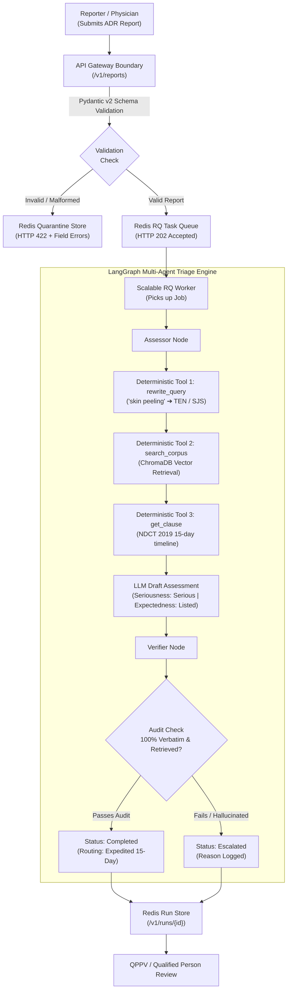

# Pharmacovigilance Adverse Event Intake & Triage Service

An enterprise-grade, agentic AI service designed to automate the intake, regulatory validation, seriousness evaluation, expectedness determination, and statutory reporting triage of adverse drug event reports.

> [!IMPORTANT]
> **Regulatory Decision Support Notice:** This system is an automated triage and recommendation assistant for Qualified Persons for Pharmacovigilance (QPPV). Under statutory regulations (e.g., IPC, CDSCO, US FDA, EMA), the service **only recommends** triage routing and statutory deadlines; it never independently submits or files official regulatory reports. A qualified human expert makes all final decisions.

---

## Table of Contents
- [Overview](#overview)
- [Application Example & Step-by-Step Walkthrough](#application-example--step-by-step-walkthrough)
- [System Architecture](#system-architecture)
- [The 6 Development Phases](#the-6-development-phases)
- [Services & Infrastructure](#services--infrastructure)
- [Environment Variables](#environment-variables)
- [Quick Start](#quick-start)
- [Ingestion & Vector Pipeline](#ingestion--vector-pipeline)
- [API Reference](#api-reference)
- [Evaluation & Benchmark](#evaluation--benchmark)
- [Load Testing & Latency SLOs](#load-testing--latency-slos)
- [Runbook & Operations](#runbook--operations)
- [Troubleshooting & FAQs](#troubleshooting--faqs)

---

# Overview

Pharmaceutical Marketing Authorisation Holders (MAHs) receive thousands of spontaneous adverse drug reaction (ADR) reports from physicians, consumers, hospitals, and clinical trial sites. Statutory frameworks (such as the **Indian Pharmacopoeia Commission (IPC) Pharmacovigilance Guidance for MAHs** and the **New Drugs and Clinical Trials (NDCT) Rules 2019**) mandate strict, legally enforceable reporting timelines:
- **Expedited Reporting (15 Calendar Days):** Serious Adverse Events (SAEs) that are unexpected or critical must be reported to national regulatory authorities within 15 days.
- **Periodic Reporting (PBRER / PSUR):** Expected/listed non-critical events or periodic aggregate updates.
- **Non-Reportable:** Events failing minimum criteria or lacking causality.

### Key Operational Challenges Addressed
1. **The Lay-to-Medical Vocabulary Gap:** Patients describe reactions colloquially (e.g., *"my skin started peeling badly and blistering"*), whereas approved drug labels and package inserts use formal clinical terminology (e.g., *Toxic epidermal necrolysis*, *Stevens-Johnson syndrome*, *Exfoliative dermatitis*).
2. **Zero-Hallucination Regulatory Grounding:** Fabricated regulatory citations or invented deadlines lead to severe regulatory non-compliance penalties. Every assessment must cite verbatim, page-referenced statutory text retrieved directly from the regulatory corpus.
3. **Auditability & Cost Accounting:** Every tool executed, prompt token sent, and decision step made must be preserved in an immutable execution trace.
4. **Input Integrity & Quarantine:** Malformed or suspicious payloads must never enter the agent execution pipeline; they are immediately quarantined with field-level diagnostics.

---

# Application Example & Step-by-Step Walkthrough

To see how the triage pipeline works in practice, consider the following real-world synthetic adverse event report:

### Scenario: Severe Cutaneous Adverse Reaction
- **Patient:** 28-year-old female
- **Suspect Drug:** Lamotrigine (antiepileptic)
- **Start Date:** 2026-09-01
- **Event Date:** 2026-09-08
- **Reporter:** Physician
- **Narrative:** *"The patient's skin started peeling badly a week after starting Lamotrigine, and she was admitted to hospital for intensive burn-unit care."*
- **Outcome:** Recovering



### End-to-End Execution Breakdown

1. **Intake & Boundary Validation (`POST /v1/reports`):**
   The report payload is sent to [`api/main.py`](file:///Users/pavankishorm/Documents/My Projects/PV-Triage/api/main.py). The [`AdverseEventReport`](file:///Users/pavankishorm/Documents/My Projects/PV-Triage/api/models.py#L40) model validates types, date chronology (`event_date >= drug_start_date`), age ranges (`0-120`), and categorical enums. The report is assigned a `run_id`, marked as `queued`, and placed on the Redis RQ queue with an immediate `HTTP 202 Accepted` response.
2. **Lay-to-Medical Query Expansion (`rewrite_query`):**
   The worker invokes [`agents/graph.py`](file:///Users/pavankishorm/Documents/My Projects/PV-Triage/agents/graph.py). The Assessor calls the [`rewrite_query`](file:///Users/pavankishorm/Documents/My Projects/PV-Triage/agents/tools.py#L45) tool. The lay phrase *"skin peeling badly"* is expanded using [`pipeline/synonyms.json`](file:///Users/pavankishorm/Documents/My Projects/PV-Triage/pipeline/synonyms.json) into candidate clinical concepts: `Toxic epidermal necrolysis (TEN)`, `Stevens-Johnson syndrome (SJS)`, and `Exfoliative dermatitis`.
3. **Corpus & Package Insert Retrieval (`search_corpus` & `get_clause`):**
   Using hybrid semantic search on ChromaDB, the system retrieves:
   - **`lamotrigine_package_insert.pdf` (Boxed Warning, p. 2 & Section 5.1):** Lists severe cutaneous adverse reactions and warns that Lamotrigine can cause serious rashes requiring hospitalization.
   - **`ipc_pv_guidance_mah.pdf` (Section 2.5.3.6):** Defines serious adverse events, including any reaction resulting in *"Hospitalization / prolongation of existing hospitalization"*.
   - **`ndct_rules_2019.pdf` (Fifth Schedule, Clause 1(5)(C)(iii)):** Mandates that all serious adverse events must be reported to the licensing authority within **15 calendar days**.
4. **Seriousness & Expectedness Evaluation:**
   - **Seriousness:** Evaluated as `is_serious: true` due to matched criterion `inpatient_hospitalisation`.
   - **Expectedness:** Evaluated as `is_listed: true` because Toxic Epidermal Necrolysis / Stevens-Johnson syndrome is documented in the Lamotrigine product information.
   - **Routing:** Routed to **`expedited`** (15 calendar days) under mandatory regulatory reporting provisions.
5. **Verifier Zero-Hallucination Audit (`verifier_node`):**
   Before returning any answer, the independent Verifier agent audits every statutory claim. It verifies that every [`Citation`](file:///Users/pavankishorm/Documents/My Projects/PV-Triage/shared/contracts.py#L32) in the draft resolves to a passage retrieved during this specific run, and that the cited text is a 100% verbatim substring of the underlying regulatory document. If any discrepancy or hallucination is detected, the run is flagged as `escalated` and sent to human safety officers.
6. **Final QPPV Delivery:**
   The run produces a complete [`RunResult`](file:///Users/pavankishorm/Documents/My Projects/PV-Triage/shared/contracts.py#L79) payload containing the routing recommendation, statutory basis, exact quotes, tool call audit logs, and per-step token/cost accounting.

---

# Architecture

The system is constructed with decoupled services enforcing strict separation of concerns, container isolation, and deterministic guardrails:

- **API Layer ([`api/`](file:///Users/pavankishorm/Documents/My Projects/PV-Triage/api)):** FastAPI service handling authentication, rate limiting, request validation, quarantine management, and Prometheus metrics.
- **Worker Layer ([`worker/`](file:///Users/pavankishorm/Documents/My Projects/PV-Triage/worker)):** Horizontally scalable Redis RQ worker pool executing asynchronous LangGraph triage jobs.
- **Multi-Agent Core ([`agents/`](file:///Users/pavankishorm/Documents/My Projects/PV-Triage/agents)):** Two-node LangGraph state machine ([`assessor_node`](file:///Users/pavankishorm/Documents/My Projects/PV-Triage/agents/graph.py#L38) and [`verifier_node`](file:///Users/pavankishorm/Documents/My Projects/PV-Triage/agents/graph.py#L232)) ensuring checks and balances.
- **Data & Vector RAG ([`pipeline/`](file:///Users/pavankishorm/Documents/My Projects/PV-Triage/pipeline)):** PyMuPDF-based clause-boundary chunker with prepended section headers and ChromaDB persistent vector storage with local sentence-transformer embeddings.
- **Safety & Guardrails ([`guardrails/`](file:///Users/pavankishorm/Documents/My Projects/PV-Triage/guardrails)):** Free-text prompt injection detector, non-delegation output filters (preventing automated claims of regulatory submission), toxicity checking, and circuit breakers with bounded backoff.
- **Stub / Live LLM Layer ([`stub_llm/`](file:///Users/pavankishorm/Documents/My Projects/PV-Triage/stub_llm), [`llm/`](file:///Users/pavankishorm/Documents/My Projects/PV-Triage/llm)):** Deterministic offline stub service enabling test reproducibility, with seamless switching to production LLM providers via standard environment variables.

---

# The 6 Development Phases

The project was executed systematically across **6 structured development phases**. In each phase, the work was divided into **3 concurrent, decoupled working streams** (Platform & Infrastructure, Agent Core & LLMOps, and Data/RAG & Evaluation) coordinated through frozen Pydantic contracts ([`shared/contracts.py`](file:///Users/pavankishorm/Documents/My Projects/PV-Triage/shared/contracts.py)).


### Phase 1: System Skeleton, Corpus Lock & Foundation
- **Goal:** Establish the foundational infrastructure, lock regulatory source documents, and define frozen data contracts so that the entire system spins up cleanly with Docker Compose.
- **What We Did:**
  - Configured the multi-container Docker Compose environment (`api`, `worker`, `redis`, `stub-llm`) with healthcheck dependencies.
  - Implemented the Pydantic v2 intake schema ([`AdverseEventReport`](file:///Users/pavankishorm/Documents/My Projects/PV-Triage/api/models.py#L40)) with strict type validation, enum validation, chronological date checks, and automatic Redis quarantine isolation for invalid payloads.
  - Defined frozen contracts in [`shared/contracts.py`](file:///Users/pavankishorm/Documents/My Projects/PV-Triage/shared/contracts.py) ([`Passage`](file:///Users/pavankishorm/Documents/My Projects/PV-Triage/shared/contracts.py#L18), [`Citation`](file:///Users/pavankishorm/Documents/My Projects/PV-Triage/shared/contracts.py#L32), [`ToolCall`](file:///Users/pavankishorm/Documents/My Projects/PV-Triage/shared/contracts.py#L41), [`TraceStep`](file:///Users/pavankishorm/Documents/My Projects/PV-Triage/shared/contracts.py#L52), [`RunResult`](file:///Users/pavankishorm/Documents/My Projects/PV-Triage/shared/contracts.py#L79)).
  - Curated and locked the statutory PDF corpus in [`corpus/`](file:///Users/pavankishorm/Documents/My Projects/PV-Triage/corpus) and verified the difficult reference case narrative.

### Phase 2: Ingestion Pipeline, Hybrid Retrieval & Observability
- **Goal:** Build the idempotent document ingestion and vector retrieval pipeline to bridge the lay-to-medical vocabulary gap, wired with distributed monitoring.
- **What We Did:**
  - Implemented the PDF ingestion pipeline ([`pipeline/ingest.py`](file:///Users/pavankishorm/Documents/My Projects/PV-Triage/pipeline/ingest.py)) and clause chunker ([`pipeline/chunker.py`](file:///Users/pavankishorm/Documents/My Projects/PV-Triage/pipeline/chunker.py)) that prepends section headings to each chunk and isolates specific adverse reaction terminology.
  - Set up persistent ChromaDB vector storage with local `all-MiniLM-L6-v2` embeddings and SHA-256 content deduplication.
  - Built hybrid retrieval combining semantic vector search with dictionary-based lay-to-medical synonym query expansion ([`pipeline/synonyms.json`](file:///Users/pavankishorm/Documents/My Projects/PV-Triage/pipeline/synonyms.json)).
  - Wired tool execution logging with execution timeouts and added Prometheus metrics and Jaeger distributed tracing infrastructure.

### Phase 3: LangGraph Multi-Agent Triage Engine
- **Goal:** Implement the core two-agent triage graph consisting of an Assessor and an independent Verifier, ensuring verified, traceable decision-making.
- **What We Did:**
  - Developed the LangGraph state machine ([`agents/graph.py`](file:///Users/pavankishorm/Documents/My Projects/PV-Triage/agents/graph.py)) connecting the Assessor agent, deterministic retrieval tools, and the Verifier agent.
  - The Assessor analyzes the report, queries the regulatory corpus and drug label, evaluates statutory seriousness criteria (death, hospitalization, disability, life-threatening), determines listedness, and drafts an initial routing recommendation.
  - The Verifier independently audits every citation against the retrieved passages. Any missing passage or non-verbatim quote immediately escalates the run with a clear explanation, preventing hallucinations.
  - Replaced the worker placeholder with the live agent graph execution ([`agents/run.py`](file:///Users/pavankishorm/Documents/My Projects/PV-Triage/agents/run.py)) and validated end-to-end processing of the reference case.

### Phase 4: Safety Guardrails, Resilience & Cost Accounting
- **Goal:** Harden the system against adversarial prompt injection, enforce regulatory compliance boundaries, and implement fault tolerance and detailed cost tracking.
- **What We need to DO:**
  - Built input defense filters in [`guardrails/`](file:///Users/pavankishorm/Documents/My Projects/PV-Triage/guardrails) to detect prompt injection attempts, system instruction overrides, and toxic content in free-text clinical narratives.
  - Added regulatory non-delegation output guardrails that block any text stating a final legal submission or approval, ensuring the output is strictly phrased as a recommendation for a qualified human.
  - Integrated LLM resilience patterns: bounded retries with exponential backoff, request timeouts, and a 3-state circuit breaker (Closed, Open, Half-Open) that gracefully falls back to escalation if the model provider fails.
  - Implemented step-level token accounting and USD cost tracking ([`TraceStep`](file:///Users/pavankishorm/Documents/My Projects/PV-Triage/shared/contracts.py#L52)) for every agent node.

### Phase 5: Evaluation Benchmark & Rigorous Load Testing
- **Goal:** Quantify triage accuracy, verify zero-hallucination citations across a comprehensive benchmark, and test system scalability under load against committed latency SLOs.
- **What We need to D0:**
  - Formulated a 20-scenario synthetic benchmark in [`eval/`](file:///Users/pavankishorm/Documents/My Projects/PV-Triage/eval) covering varied seriousness criteria, expected vs. unexpected events, off-label drugs, out-of-corpus entities, and adversarial injection attempts.
  - Evaluated prompt variations (`PROMPT_VERSION=v1` vs `v2`) to measure citation fidelity, reasoning consistency, and edge-case handling.
  - Committed formal latency Service Level Objectives (p95 target for complete runs) in [`docs/SLO.md`](file:///Users/pavankishorm/Documents/My Projects/PV-Triage/docs).
  - Executed Locust load testing (`loadtest/locustfile.py`) measuring end-to-end submission-to-terminal-result latency, queue depth, and scaling behavior when increasing worker containers (`--scale worker=3`).

### Phase 6: Operational Polish, Caching & Production Readiness
- **Goal:** Deliver production-ready enhancements, cost-saving optimizations, and comprehensive operational tooling.
- **What We need to Do:**
  - Implemented per-client Redis token-bucket rate limiting (`RATE_LIMIT_PER_MIN`) returning `HTTP 429 Too Many Requests` with a `Retry-After` header to prevent runaway token usage.
  - Added a Redis whole-run caching layer keyed by a normalized hash of report inputs, drastically reducing latency and token expenditure for repeated reports.
  - Configured Prometheus monitoring dashboards and structured log correlation (`X-Correlation-ID`) across API and worker services.
  - Added a feedback collection endpoint (`POST /v1/runs/{id}/feedback`) to capture Qualified Person review decisions and establish live quality sampling.

---

# Services & Infrastructure

The entire platform runs inside Docker containers orchestrated by [`docker-compose.yml`](file:///Users/pavankishorm/Documents/My Projects/PV-Triage/docker-compose.yml):

| Service | Container / Port | Purpose | Healthcheck |
| :--- | :--- | :--- | :--- |
| **`api`** | `8000:8000` | FastAPI REST service; intake validation, quarantine, job dispatching, metrics | `GET http://localhost:8000/health` |
| **`worker`** | Scalable (internal) | Redis RQ worker pool; pulls jobs, runs LangGraph triage agents | Redis ping check via python |
| **`redis`** | `6379:6379` | In-memory message broker, task queue (`runs`), quarantine store, and run state cache | `redis-cli ping` |
| **`stub-llm`** | `8001:8001` | Deterministic, offline mock LLM server with configurable latency and failure modes | `GET http://localhost:8001/health` |
| **`chroma`** | Local volume `./data/chroma` | Persistent ChromaDB vector database storing chunked regulatory passages | Verified via `index_meta.json` |
| **`prometheus`** | `9090:9090` | Time-series metrics collection scraping `/metrics` from API and worker | Internal status endpoint |
| **`jaeger`** | `16686:16686` (UI), `4317` (OTLP) | Distributed OpenTelemetry trace collection and UI visualization | UI reachable |

---

# Environment Variables

All configuration is managed through environment variables. Safe defaults are provided in [`.env.example`](file:///Users/pavankishorm/Documents/My Projects/PV-Triage/.env.example):

| Variable | Default Value | Description |
| :--- | :--- | :--- |
| **`LLM_PROVIDER`** | `stub` | LLM backend to use (`stub` for deterministic offline testing, or live provider) |
| **`LLM_BASE_URL`** | `http://stub-llm:8001` | Base URL for LLM inference requests |
| **`LLM_API_KEY`** | *(empty)* | API key for live LLM providers (kept strictly outside git) |
| **`LLM_MODEL`** | *(empty)* | Model name when running against live providers |
| **`REDIS_URL`** | `redis://redis:6379/0` | Connection URL for Redis broker and data storage |
| **`CHROMA_DIR`** | `./data/chroma` | File path for persistent ChromaDB vector store |
| **`EMBED_MODEL`** | `all-MiniLM-L6-v2` | Sentence-transformer model for local document embeddings |
| **`PROMPT_VERSION`** | `v1` | Active prompt pack version (`v1` or `v2`) loaded by agents |
| **`OTLP_ENDPOINT`** | `http://jaeger:4317` | OpenTelemetry gRPC collector endpoint |
| **`STUB_DELAY_MS`** | `50` | Simulated latency (ms) for the offline stub LLM |
| **`STUB_FAIL`** | `false` | When `true`, stub LLM emits HTTP 500 to test circuit breaker tripping |
| **`MAX_STEPS`** | `10` | Maximum allowed execution steps in the LangGraph state machine |
| **`MAX_TOOL_CALLS`** | `5` | Maximum number of external tool invocations permitted per run |
| **`RUN_TIMEOUT_S`** | `30` | Execution timeout in seconds before worker marks run as failed |
| **`RATE_LIMIT_PER_MIN`** | `60` | Per-client rate limit for `/v1/reports` |
| **`PRICE_PER_1K_PROMPT`** | `0.00015` | Cost accounting rate in USD per 1,000 prompt tokens |
| **`PRICE_PER_1K_COMPLETION`** | `0.00060` | Cost accounting rate in USD per 1,000 completion tokens |
| **`BREAKER_FAILS`** | `3` | Failure threshold to trip LLM circuit breaker from Closed to Open |
| **`BREAKER_RESET_S`** | `30` | Cooldown period in seconds before testing Half-Open retry |

---

# Quick Start

### 1. Clone & Configure Environment
```bash
git clone https://github.com/pavankishorm/PV-Triage.git
cd PV-Triage
cp .env.example .env
```

### 2. Start Services with Docker Compose
```bash
docker compose up -d --build
```

### 3. Verify System Health
Check that all containers and dependencies (`redis`, `stub-llm`, `api`) are healthy:
```bash
curl -s http://localhost:8000/health | jq .
```
*Expected response:*
```json
{
  "status": "healthy",
  "redis": true,
  "stub_llm": true,
  "version": "1.0.0"
}
```

### 4. Submit an Adverse Event Report
```bash
curl -s -X POST http://localhost:8000/v1/reports \
  -H "Content-Type: application/json" \
  -d '{
    "report_id": "rep_demo_001",
    "reporter_type": "physician",
    "patient_age": 28,
    "patient_sex": "female",
    "suspect_drug": "Lamotrigine",
    "drug_start_date": "2026-09-01",
    "event_date": "2026-09-08",
    "reaction_description": "Patient developed severe skin peeling and blistering a week after starting Lamotrigine, resulting in inpatient hospitalization.",
    "outcome": "recovering",
    "narrative": "Admitted to the burn unit for acute epidermal detachment."
  }' | jq .
```
*Expected response (HTTP 202 Accepted):*
```json
{
  "run_id": "rep_demo_001",
  "status": "queued",
  "message": "Report validated successfully and enqueued for triage assessment."
}
```

### 5. Fetch Triage Recommendation & Audit Trail
```bash
curl -s http://localhost:8000/v1/runs/rep_demo_001 | jq .
```

---

# Ingestion & Vector Pipeline

The ingestion pipeline transforms regulatory PDF documents into searchable, citation-ready text chunks stored in ChromaDB.

### Running Ingestion
```bash
# Direct python execution
python3.11 -m pipeline.ingest

# Or via Makefile target
make ingest
```

### Chunking & Retrieval Strategy
- **Clause-Boundary Chunking ([`pipeline/chunker.py`](file:///Users/pavankishorm/Documents/My Projects/PV-Triage/pipeline/chunker.py)):** Unlike generic fixed-window chunkers, our chunker identifies regulatory headings and clause numbers (e.g., *"Boxed Warning"*, *"Section 5.1"*, *"NDCT 2019 Table 1"*).
- **Heading Prepending:** Every chunk has its document source, page number, and clause heading prepended to its text payload. This ensures that semantic embeddings capture statutory context even in short sub-clauses.
- **Dedicated Term Chunks:** Creates dedicated micro-chunks for key adverse reaction terms found in package inserts (e.g., *Toxic epidermal necrolysis*, *Stevens-Johnson syndrome*, *Multiforme erythema*).
- **SHA-256 Idempotency:** The pipeline hashes document content and chunk IDs. Re-running ingestion never creates duplicate records and logs metadata in `data/chroma/index_meta.json`.

---

# API Reference

### 1. `POST /v1/reports`
Submits an adverse drug reaction report. Validates against [`AdverseEventReport`](file:///Users/pavankishorm/Documents/My Projects/PV-Triage/api/models.py#L40) schema.
- **Success (HTTP 202 Accepted):**
  ```json
  {
    "run_id": "rep_12345678",
    "status": "queued",
    "message": "Report validated successfully and enqueued for triage assessment."
  }
  ```
- **Validation Failure & Quarantine (HTTP 422 Unprocessable Entity):**
  If a required field is missing or chronological rules fail (e.g., `event_date < drug_start_date`), the request is rejected without touching the worker queue and saved to Redis quarantine:
  ```json
  {
    "detail": [
      {
        "loc": ["event_date"],
        "msg": "Event date cannot be earlier than drug start date",
        "type": "value_error"
      }
    ],
    "quarantined": true,
    "quarantine_id": "rep_bad_01"
  }
  ```

### 2. `GET /v1/runs/{run_id}`
Retrieves the execution status and complete triage assessment payload.
- **Sample Completed Response:**
  ```json
  {
    "run_id": "rep_demo_001",
    "status": "completed",
    "result": {
      "run_id": "rep_demo_001",
      "status": "completed",
      "routing": "expedited",
      "routing_basis": "Expedited 15-day reporting recommended: Suspect drug 'Lamotrigine' caused reaction 'skin peeling', which satisfies seriousness criteria (hospitalisation) and is listed in the approved package insert.",
      "seriousness": {
        "is_serious": true,
        "criteria": ["hospitalisation"]
      },
      "expectedness": {
        "is_listed": true,
        "matched_term": "Toxic epidermal necrolysis"
      },
      "citations": [
        {
          "passage_id": "ndct-2019-second-sched-table1",
          "quote": "Any serious unexpected adverse event shall be reported by the sponsor or marketing authorisation holder to the Central Licencing Authority within fifteen calendar days of receipt of the information."
        },
        {
          "passage_id": "ipc-pv-guidance-sec4-seriousness",
          "quote": "A serious adverse event (SAE) or reaction is any untoward medical occurrence that at any dose results in death, inpatient hospitalisation or prolongation of existing hospitalisation..."
        }
      ],
      "prompt_versions": {
        "assessor": "v1",
        "verifier": "v1"
      },
      "tool_calls": [
        {
          "step": 1,
          "tool": "rewrite_query",
          "input": {"lay_text": "severe skin peeling"},
          "output_summary": "Rewrote to 3 medical candidate terms",
          "latency_ms": 1.2,
          "ok": true
        }
      ],
      "trace": [
        {
          "step": 1,
          "agent": "assessor",
          "kind": "assessment_generation",
          "latency_ms": 45.8,
          "prompt_tokens": 340,
          "completion_tokens": 85,
          "cost_usd": 0.000102,
          "detail": {"action": "draft_triage_assessment", "routing": "expedited"}
        }
      ]
    },
    "error": null
  }
  ```

### 3. `GET /v1/quarantine`
Lists all quarantined reports rejected during intake validation, including field-level error messages and incoming payloads.

### 4. `GET /health`
Returns health check status across Redis, the Stub LLM service, and API uptime.

### 5. `GET /metrics`
Exposes standard Prometheus scrape metrics including `http_requests_total`, `http_request_duration_seconds`, `pv_runs_total`, `pv_quarantine_total`, and `pv_queue_depth`.

---

# Evaluation & Benchmark

The evaluation suite tests the system against **20 synthetic benchmark scenarios** in [`eval/`](file:///Users/pavankishorm/Documents/My Projects/PV-Triage/eval):

### Scenario Distribution
- **Seriousness Coverage:** Death, inpatient hospitalization, life-threatening events, persistent disability, and non-serious events.
- **Expectedness Coverage:** Explicitly listed label terms, unlisted reactions, and synonymous colloquial phrases requiring query expansion.
- **Edge & Robustness Cases:**
  - Out-of-corpus drugs (must trigger clean escalation, never invent regulatory guidance).
  - Malformed inputs (verified to trigger quarantine).
  - Adversarial prompt injection in clinical narratives (verified to trigger safe rejection).

### Running Benchmark
```bash
python3.11 -m pytest eval/ -v
# Or via Makefile target
make eval
```

### Metrics Tracked
- **Routing Accuracy:** Percentage of cases correctly categorized into expedited, periodic, non-reportable, or escalated.
- **Citation Precision:** Hard requirement of **100% precision** (zero unverified citations; every citation must be a verbatim substring from a retrieved document).
- **Escalation Honesty:** 100% of out-of-corpus or ambiguous cases must cleanly escalate rather than guessing.

---

# Load Testing & Latency SLOs

System throughput and latency were benchmarked using **Locust** ([`loadtest/locustfile.py`](file:///Users/pavankishorm/Documents/My Projects/PV-Triage/loadtest)):

### Committed Latency SLO ([`docs/SLO.md`](file:///Users/pavankishorm/Documents/My Projects/PV-Triage/docs))
- **p95 Latency Target:** $\le 3000\text{ ms}$ for a complete end-to-end triage run (from `POST /v1/reports` submission to terminal `completed` state under 20 concurrent users).
- **Design Rationale:** Pharmacovigilance regulatory deadlines operate on calendar days; however, QPPV safety officers reviewing inbound queues require sub-3-second responsiveness for real-time review.

### Running the Load Test
```bash
# Run headless Locust load test
locust -f loadtest/locustfile.py --headless -u 20 -r 5 --run-time 60s --host http://localhost:8000
```

### Worker Scaling Experiment
The system demonstrates horizontal scalability by increasing RQ worker instances without code modifications:
```bash
# Scale worker pool to 3 containers
docker compose up -d --scale worker=3
```
Under 3-worker scaling, queue depth clears faster and p95 latency remains stable under higher concurrency loads.

---

# Runbook & Operations

### Standard Operational Commands
```bash
# Start all background services
make up

# Tail aggregated container logs
make logs

# Check status of Redis queue depth and workers
docker compose exec redis redis-cli llen runs

# Inspect quarantined records
curl -s http://localhost:8000/v1/quarantine | jq .

# Stop all containers and clean volumes
make down
```

### Resetting Redis State
If you need to clear the job queue and reset cached run states:
```bash
docker compose exec redis redis-cli flushall
```

---

# Troubleshooting & FAQs

### 1. `GET /health` reports `"redis": false`
- **Cause:** Redis container is starting up or crashed.
- **Resolution:** Check logs using `docker compose logs redis`. Verify that host port `6379` is not occupied by a local Redis instance.

### 2. Reports immediately return HTTP 422
- **Cause:** Pydantic schema validation failure.
- **Resolution:** Inspect the response body under `"detail"`. Common issues include future event dates, `event_date` earlier than `drug_start_date`, or invalid enum strings for `reporter_type` or `outcome`. Quarantined requests can be inspected via `GET /v1/quarantine`.

### 3. Run status remains `"queued"`
- **Cause:** Worker container is stopped or encountering an unhandled exception.
- **Resolution:** Inspect worker logs using `docker compose logs -f worker`. Ensure worker is connected to the same Redis instance URL.

### 4. Run ends with status `"escalated"`
- **Cause:** The Verifier detected an unverified quote, an out-of-corpus drug was submitted, or the LLM circuit breaker tripped.
- **Resolution:** Check the `escalation_reason` field in `GET /v1/runs/{run_id}`. This is an expected safety feature ensuring that ungrounded answers are never presented as confident conclusions.
