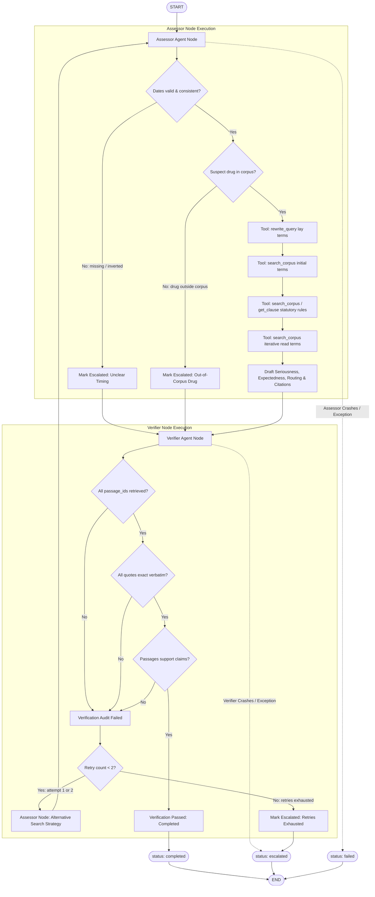

# LangGraph Multi-Agent Triage Topology & Failure Behavior

**Branch:** `b/agents`  
**Owner:** Member B (Agent Core & LLMOps)  
**Phase:** Phase 3 (Multi-Agent Assessor & Verifier Architecture)  
**Conforming Data Contracts:** [shared/contracts.py](file:///home/namit/PV-Triage/shared/contracts.py)  

---

## 1. System Topology Overview

The pharmacovigilance triage engine is designed as a stateful, multi-agent directed acyclic workflow orchestrated via LangGraph. To ensure safety, regulatory compliance, and auditability, execution duties are strictly partitioned between two distinct agents:

1. **Assessor Agent (`assessor_node`)**:
   - Gathers report fields and checks timing/dates for chronological consistency.
   - Verifies suspect drug presence in the approved regulatory corpus.
   - Bridges the colloquial-to-clinical vocabulary gap via `rewrite_query`.
   - Discovers statutory provisions and package insert warnings using `search_corpus` and `get_clause`.
   - Re-queries iteratively using vocabulary discovered during evidence retrieval.
   - Drafts seriousness, expectedness, and expedited/periodic routing with exact passage citations.

2. **Verifier Agent (`verifier_node`)**:
   - Operates with an adversarial, isolated perspective on the drafted assessment.
   - Verifies that **every** cited `passage_id` was genuinely retrieved during the run.
   - Enforces that **every** quote is an exact verbatim substring of the retrieved passage text.
   - Audits that the retrieved statutory and clinical passages strictly justify the legal claims.
   - Implements a closed-loop retry mechanism (max 2 retries) providing structured feedback and requesting alternative search strategies if citations fail audit.
   - Ensures an unverified or incomplete run is **never** returned as a confident answer (Global Rule 6).

---

## 2. Mermaid Workflow Diagram

---

## 3. Failure Behavior & Escalation Matrix

Per Phase 3 specifications and Global Rule 6 (*"An unverified or incomplete run must never be returned as a confident answer"*), failure behavior distinguishes between system crashes and verification escalations:

| Failure Mode / Trigger | Originating Node / Cause | System Action | Final Run Status | Escalation / Failure Reason | Rationale & Safety Invariant |
| :--- | :--- | :--- | :--- | :--- | :--- |
| **Assessor Node Crash** | `assessor_node` unhandled exception (e.g., syntax, runtime crash, memory error) | Catches exception, aborts assessment drafting, records stack trace step | `failed` | `Assessor crashed: <error_message>` | Primary assessment could not be formulated. A system-level crash must fail honestly without output. |
| **Verifier Node Crash** | `verifier_node` unhandled exception (e.g., audit parsing error) | Catches exception, prevents unverified output from release, escalates immediately | `escalated` | `Verifier crashed: <error_message>. Escalating run per safety protocol (Global Rule 6).` | The assessment exists but cannot be verified. Per Global Rule 6, unverified results must be escalated to a qualified person. |
| **Out-of-Corpus Suspect Drug** | `assessor_node` detects suspect drug not present in corpus (e.g., Metformin, Warfarin) | Issues tool search to verify absence, terminates drafting, flags for human evaluation | `escalated` | `Suspect drug '<drug>' is outside the approved regulatory corpus. Escalating for manual medical review.` | Cannot invent regulatory information or package insert text (Global Rule 2). A qualified person must review. |
| **Missing or Unclear Timing** | `assessor_node` detects missing `drug_start_date` or `event_date` | Aborts automated triage timeline calculations | `escalated` | `Timing is unclear: report is missing drug_start_date or event_date.` | Expedited reporting clocks (15 days) cannot be calculated without unambiguous temporal anchor dates. |
| **Inconsistent Chronology** | `assessor_node` detects `event_date < drug_start_date` | Flags chronological contradiction | `escalated` | `Timing is unclear: event_date (<event>) precedes drug_start_date (<start>).` | Event onset before drug initiation invalidates causal chronology; requires human investigator review. |
| **Unmatchable Reaction** | `assessor_node` cannot map lay reaction to package insert with confidence | Rewrites query, detects zero clinical confidence, escalates | `escalated` | `Reaction '<reaction>' cannot be matched to the package insert with confidence.` | Low-confidence or hallucinated clinical mappings violate regulatory reporting integrity. |
| **Verification Citation Failure (Attempt 1-2)** | `verifier_node` finds cited `passage_id` not retrieved or quote not verbatim | Emits structured verifier feedback, switches to clause lookup / verbatim extraction | `running` (loops back) | Loop feedback: `Verification audit failed (attempt N/2): 
` | Allows self-correction loop where Assessor re-queries authoritative clauses directly. |
| **Verification Citation Failure (Retries Exhausted)** | `verifier_node` catches persistent audit failure after 2 retries | Exhausts retries, blocks completion, escalates to human | `escalated` | `Verification failed after 2 retries: 
` | Guarantees that unsupported or hallucinated citations are never delivered as completed assessments. |
| **Tool Call Limit Exceeded** | `tool_log` count reaches `MAX_TOOL_CALLS` | Traps `ToolCallLimitExceeded`, halts tool loop, escalates | `escalated` | `Tool call limit exceeded: N/20 (MAX_TOOL_CALLS=20).` | Enforces bound execution and prevents infinite API consumption or tool thrashing. |
| **Execution Timeout Exceeded** | Wall-clock latency exceeds `RUN_TIMEOUT_S` | Checks elapsed runtime before agent step, halts execution | `escalated` | `RUN_TIMEOUT_S exceeded: elapsed Ns > 30.0s limit.` | Enforces bounded SLAs and prevents hung worker threads. |
| **Graph Step Bound Exceeded** | Workflow step count reaches `MAX_STEPS` | Enforces loop boundary, halts execution | `escalated` | `MAX_STEPS exceeded: executed N steps >= 15 limit.` | Guarantees loop termination even in pathological cyclic state conditions. |

---

## 4. Contract & Invariant Guarantees

1. **State Isolation**: The Verifier evaluates determinations purely against the retrieved corpus passages and statutory constraints. It does not blindly trust Assessor claims.
2. **Citation Integrity**: Every `Citation` in a `completed` run has `passage_id` present in `RunResult.tool_calls`/retrieved evidence and `quote in passage.text`.
3. **Trace Accounting**: Every node execution records latency in milliseconds, prompt tokens, completion tokens, USD cost, and structured decision details.
4. **Prompt Provenance**: Every participating agent records its prompt template version in `RunResult.prompt_versions` (`assessor`, `verifier`, `rewrite`).
